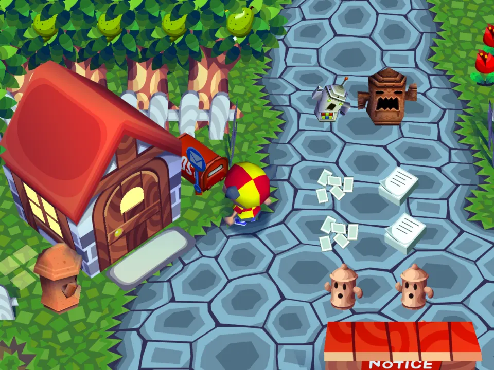
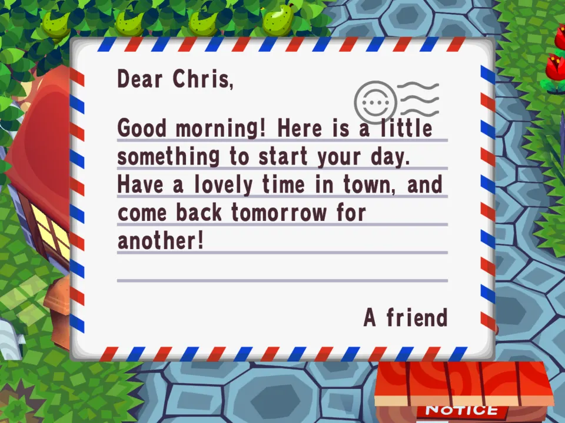

# Harvest Post

A World mod (`"scope": "world"`) in two halves:

- **The calendar** (`calendar.json`, `letters.json`, `talk.json`): two days of our own.
  The Harvest Fair is the third Wednesday of September and Apple Day is
  October 21. A notice goes up on the bulletin board and villagers talk about
  it all day.
- **The post** (`main.lua`, `messages/en.json`): once a game day, a script
  mails you a letter with a little present. On fair day it runs a fruit
  contest with a 100 Bell entry fee. A worked example of mod commands, a
  question, a setting, a timer and a function other mods can call.

A board notice changes the town, so the whole mod is a World mod. It still
does not count for a friend visit: only a World mod with textures, shops or
items does, so two friends need not both have it. The board notice goes up in
the player's own town only. The script half alone would run in a Just you mod
too.

## In the game


On the third Wednesday of September the town bulletin board carries the mod's notice, dated by the game.


All day, villagers open with a line about the fair from the mod's talk.json, then carry on in their own words.



The day's first visit to town: the mod's script has already mailed today's letter, so there is mail waiting at the house.



The letter is the mod's own text, from its messages file, sent with the send_letter command from "A friend", with a little present attached.

[](media/film.mp4)

The film (click the picture): The Harvest Fair notice on the bulletin board and Twiggy talking about the fair before her usual chat, then a walk to the mailbox to take out the day's letter and read it.

## The calendar

- It adds two calendar days. The Harvest Fair is the third Wednesday of
  September (`week` 3, `weekday` 3). Apple Day is October 21 (`day`).
- On each day a notice goes up on the town bulletin board. It is posted once,
  in the player's own town only.
- `talk.json` has a pool for each day: `"day"` names the calendar day by its
  `id`, and `"place": "before"` puts the line before the villager's hello.
  Every pool names its place; the others are the hello itself, the topic
  after a chat answer, a line after the topic, and the whole conversation.
- `letters.json` holds two letter templates. The player's name goes where
  `{player}` is, and an apple comes with each.
- `fair-thanks` is mailed by the script, with
  `cmd.send_letter{ template = "fair-thanks" }`, once a player pays to enter
  the fruit contest. Another mod's command would name it
  `example.harvest-post:fair-thanks`.
- `apple-day` is mailed by the calendar, with no script: the Apple Day entry
  in `calendar.json` says `"letter": "apple-day"`. It goes out once on the day,
  the first time the player is free in their own town, and it counts against
  the mod's 3 letters a day.
- The thank-you signs "The Fair Committee". The mailbox list has room for 8
  characters, so `sender` names it "The Fair" there.

Letter and notice text is plain ASCII and must fit six lines of the paper. The
game measures it in its own font and refuses text that does not fit.

## The post: commands

An event handler never changes the game itself. It queues a command, and the
game applies it at the end of a frame's update, once the player is free.

- `cmd.send_letter{ text = ..., item = ..., from = ... }` queues the letter.
  It returns the command's id, or `nil`, a message and a code when the game
  refuses it now. The text and the sender come from `messages/en.json`, read
  with `message("letter")` and `message("from")`.
- `"permissions": ["send_letter"]` in `mod.json` names the command. A
  command the mod does not name is refused.
- `command_finished` says what happened to it: `e.ok`, `e.via`
  (`mailbox`, or `post_office` when the mailbox was full), or `e.code` and
  `e.message` for a refusal.
- The game's cap is 3 letters a day from one mod, per town. The refusal's code
  is `command-day-cap`.

## The post: a setting

`mod.json` declares one setting, `present`, a `choice` of `fruit` or `none`.
The player sets it on the Mods tab, and `settings.get("present")` reads it.
With `none` the daily letter comes with no present.

- A setting has no `scope`, so it is `world`, the default: the value is part
  of the town. A friend visit compares it, and a visitor lent the mod runs the
  host's value.
- A World setting may decide what the town gets, so the letter command after
  it is allowed. A `"scope": "client"` setting is each player's own, and in a
  handler that read one the game refuses `send_letter`, `give_item`,
  `take_item` and `take_bells` with `command-client-setting`. The script kit
  shows a client setting.

## The fruit contest: a question and a take

On the Harvest Fair, the first time a resident enters the town, the script
asks them to enter the fruit contest.

- `cmd.ask{ text = message("contest"), choices = { "Apple", "Pear", "Not today" } }`
  puts the question in the player's thought window. It has 2 to 4 answers of
  up to 16 characters.
- `question_answered` brings back `e.id` (what `cmd.ask` returned),
  `e.choice` (counting from 1) and `e.text`. Both are `nil` when the window
  closed with no pick.
- For Apple or Pear, `cmd.take_bells{ amount = 100 }` asks for the fee. The
  game shows its own question, which names the amount and the mod, and the
  player says yes or no there. The script cannot change those words.
- `command_finished` with `e.command == "take_bells"` says how it went:
  `e.via` is `"taken"` on yes, and `e.code` is `command-declined` on no, or
  `command-not-held` when the wallet holds less than 100 Bells.
- Once the fee is taken the script mails `fair-thanks`.
- A take is refused on a visit, so the contest is asked only at home:
  `store.town()` starts with `"v:"` away from home.

## The fair at 6 PM: hour_changed and show_line

`hour_changed` fires on the game's own hourly update, with `e.hour` from 0 to
23. At 18 on fair day the script runs `cmd.show_line(message("packing_up"))`,
which puts a line in the player's thought window once they are free.

`game.calendar_today()` tells the script which of its calendar days fall today.
It lists this mod's own days only, by their `id` in `calendar.json`.

## A function other mods can call

`remote.add("fair_today", ...)` offers a function to other mods while the
script loads. `"exports"` in `mod.json` lists it, with one line that says what
it returns, and the game then lets the script offer only the names listed.

Another mod names Harvest Post in `"optional_depends"` and calls it:

```lua
if remote.version("example.harvest-post") and remote.has("example.harvest-post", "fair_today") then
  local fair = remote.call("example.harvest-post", "fair_today")
end
```

The script kit in the modding guide does exactly that.

## The post: timers

A letter the game could not take now (both boxes full, or the player away from
home) is tried again half a game hour later.

- `timer.after(30, "retry", p.id)` counts game minutes. The timer is kept with
  the town's data, so it still fires after a save and a reload.
- `timer_fired` brings back the name and the data: here, whose letter it was.
- `timer.cancel(id)` cancels a waiting timer. When the letter gets through on
  the next scene first, the script cancels the retry.

## The post: saved data

- `store.player` remembers the day's letter, so each resident of the town gets
  their own.
- The town's `store` keeps the mark that a retry timer is waiting, under the
  resident's id. The timer may fire while another resident plays, and only the
  town's store can be cleared then.
- `rng()` counts the numbers the mod drew in this town today and keeps that
  count with the town, so reloading the game cannot reroll the present.

## The post: events

`day_started` sends the day's letter. `scene_entered` tries too, since a game
loaded on a day it already saw does not run `day_started` again.

`command_finished` comes for every command, the line and the question too
(`e.via` is `"shown"` for those), so the script reads `e.command` first.

`letter_read` fires when the player reads a letter. `e.letter` is
`"example.harvest-post:fair-thanks"` or `"example.harvest-post:apple-day"` for
this mod's templates, and `nil` for a letter sent as plain `text`.

## Install

In Play AC Online, open the Mods tab. Harvest Post is in the mod list as an
official example: install it from there. Or download its ZIP from the
[cookbook](https://playaconline.com/modding/cookbook/) and add the file in the
Mods tab.

## Make your own

This repository is one mod, laid out the way the GitHub import wants it:
`mod.json` at the top, and a tag named for the version in `mod.json`.

1. Copy the repository to your own account.
2. Change `"id"` in `mod.json` to your own, like `yourname.harvest-post`.
   Ids that start with `example.` are kept for these examples, so the import
   refuses them.
3. Tag the commit with the version, like `v1.0.0`.
4. In the Mods tab, choose Import from GitHub and paste
   `github.com/<you>/<repository>@v1.0.0`.

To keep only one half, delete the other half's files and its lines in
`mod.json`, and `playac-mod check` tells you if anything still points at them.

The modding guide is at [playaconline.com/modding](https://playaconline.com/modding/).

`media/` holds the pictures and the film the cookbook shows, with their
captions in `media/media.json`. `.playac/screenshots/` holds the listing's
screenshots. The pack rule leaves the pictures, the film and the screenshots
out of the mod.

## License

MIT, see [LICENSE](LICENSE).
