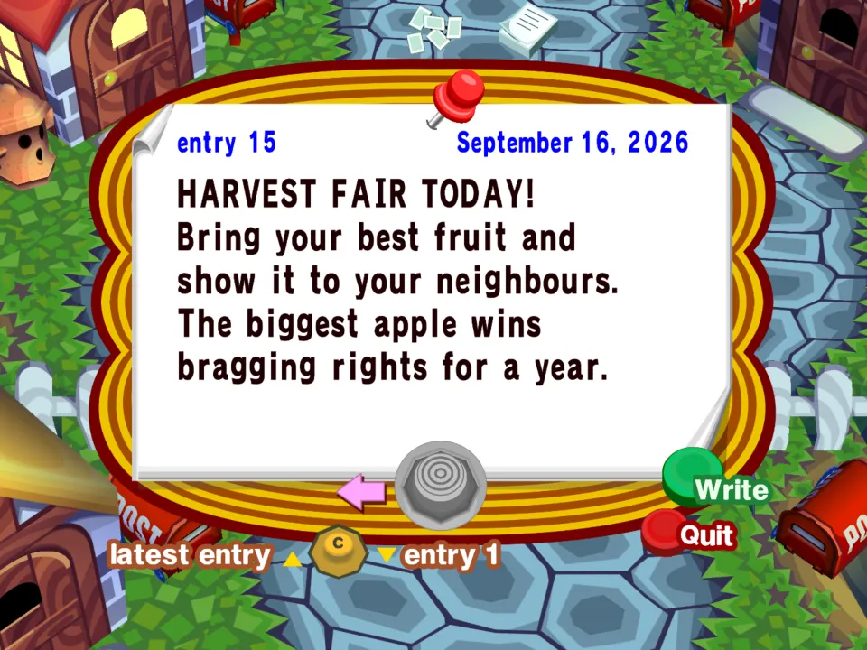
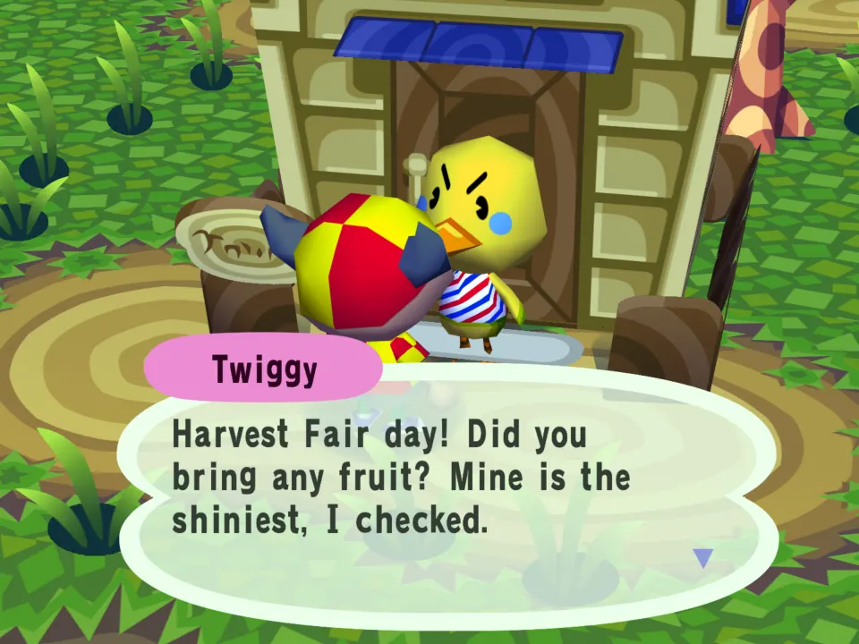
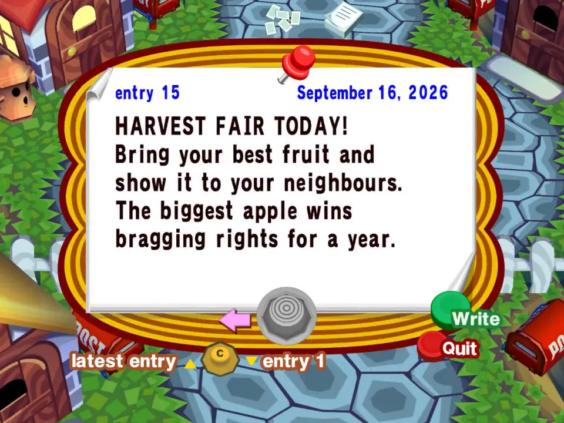

# Harvest Post

A World mod (`"scope": "world"`) in two halves:

- **The calendar** (`calendar.json`, `letters.json`): two days of our own.
  The Harvest Fair is the third Wednesday of September and Apple Day is
  October 21. A notice goes up on the bulletin board and villagers talk about
  it all day.
- **The post** (`main.lua`, `messages/en.json`): once a game day, a script
  mails you a letter with a little present. A worked example of mod commands
  and a timer.

A board notice changes the town, so the whole mod is a World mod. The script
half would run in a Just you mod too.

## In the game

On the third Wednesday of September the town bulletin board carries the mod's notice, dated by the game.

All day, villagers open with a line about the fair from the mod's calendar.json, then carry on in their own words.

The day's first visit to town: the mod's script has already mailed today's letter, so there is mail waiting at the house.

The letter is the mod's own text, from its messages file, sent with the send_letter command from "A friend", with a little present attached.

The film (click the picture): The Harvest Fair notice on the bulletin board and Twiggy talking about the fair before her usual chat, then a walk to the mailbox to take out the day's letter and read it.

## The calendar

- It adds two calendar days. The Harvest Fair is the third Wednesday of
  September (`week` 3, `weekday` 3). Apple Day is October 21 (`day`).
- On each day a notice goes up on the town bulletin board. It is posted once,
  in the player's own town only. Villagers say one of the day's lines before
  their hello.
- `fair-thanks` in `letters.json` is a letter template. A script of this mod
  can mail it with `cmd.send_letter{ template = "fair-thanks" }`, and another
  mod's command names it `example.harvest-post:fair-thanks`. The player's name goes
  where `{player}` is, and an apple comes with it.
- The letter signs "The Fair Committee". The mailbox list has room for 8
  characters, so `sender` names it "The Fair" there.

Letter and notice text is plain ASCII and must fit six lines of the paper. The
game measures it in its own font and refuses text that does not fit.

## The post: commands

An event handler never changes the game itself. It queues a command, and the
game applies it at the end of a frame's update, once the player is free.

- `cmd.send_letter{ text = ..., item = ..., from = ... }` queues the letter.
  It returns the command's id, or `nil`, a message and a code when the game
  refuses it now. The text and the sender come from `messages/en.json`, read
  with `message("letter")` and `message("from")`.
- `"permissions": ["send_letter"]` in `mod.json` names the command. A
  command the mod does not name is refused.
- `command_finished` says what happened to it: `e.ok`, `e.via`
  (`mailbox`, or `post_office` when the mailbox was full), or `e.code` and
  `e.message` for a refusal.
- The game's cap is 3 letters a day from one mod, per town. The refusal's code
  is `command-day-cap`.

## The post: timers

A letter the game could not take now (both boxes full, or the player away from
home) is tried again half a game hour later.

- `timer.after(30, "retry", p.id)` counts game minutes. The timer is kept with
  the town's data, so it still fires after a save and a reload.
- `timer_fired` brings back the name and the data: here, whose letter it was.

## The post: saved data

- `store.player` remembers the day's letter, so each resident of the town gets
  their own.
- The town's `store` keeps the mark that a retry timer is waiting, under the
  resident's id. The timer may fire while another resident plays, and only the
  town's store can be cleared then.
- `rng()` counts the numbers the mod drew in this town today and keeps that
  count with the town, so reloading the game cannot reroll the present.

## The post: events

`day_started` sends the day's letter. `scene_entered` tries too, since a game
loaded on a day it already saw does not run `day_started` again.

## Install

In Play AC Online, open the Mods tab. Harvest Post is in the mod list as an
official example: install it from there. Or download its ZIP from the
[cookbook](https://playaconline.com/modding/cookbook/) and add the file in the
Mods tab.

## Make your own

This repository is one mod, laid out the way the GitHub import wants it:
`mod.json` at the top, and a tag named for the version in `mod.json`.

1. Copy the repository to your own account.
2. Change `"id"` in `mod.json` to your own, like `yourname.harvest-post`.
   Ids that start with `example.` are kept for these examples, so the import
   refuses them.
3. Tag the commit with the version, like `v1.0.0`.
4. In the Mods tab, choose Import from GitHub and paste
   `github.com/<you>/<repository>@v1.0.0`.

To keep only one half, delete the other half's files and its lines in
`mod.json`, and `playac-mod check` tells you if anything still points at them.

The modding guide is at [playaconline.com/modding](https://playaconline.com/modding/).

`media/` holds the pictures and the film the cookbook shows, with their
captions in `media/media.json`. `.playac/screenshots/` holds the listing's
screenshots. The pack rule leaves the pictures, the film and the screenshots
out of the mod.

## License

MIT, see [LICENSE](LICENSE).
